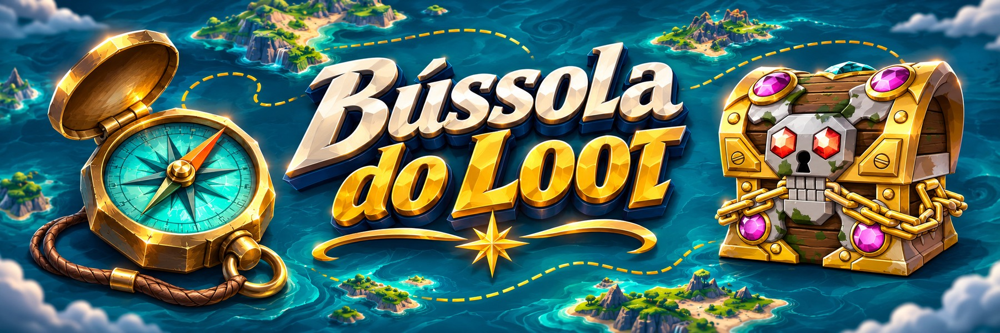
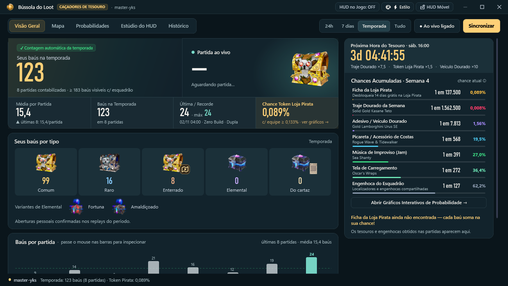
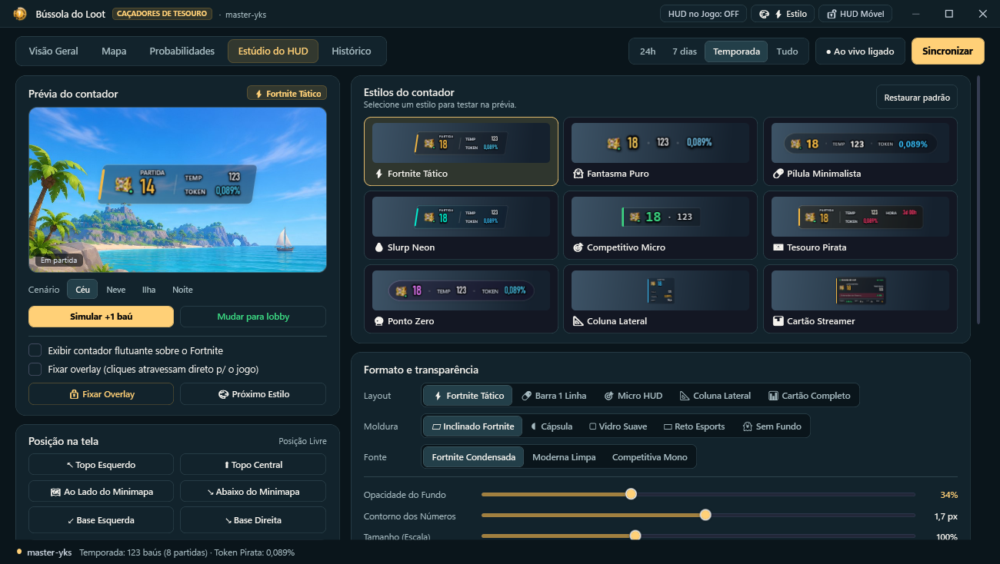

# Bússola do Loot

**Conte seus baús no Fortnite, confira o que o replay registrou do seu esquadrão, acompanhe suas chances de recompensa e planeje a próxima rota em Crossbones Isle.**

Aplicativo nativo para **Windows x64**, em português do Brasil, por **master-yks** — leve, rápido, acessível por teclado e com instalador único pronto para uso.

---

## Instalação (apenas 1 instalador)

1. Acesse a aba [**Releases**](https://github.com/master-yks/bussola-do-loot/releases/latest) e baixe o único instalador oficial:
   - **`BussolaDoLoot-Setup-win-x64.exe`**
2. Execute o instalador e avance no assistente.
   - O runtime **.NET 10** já está incluído — não é preciso instalar nada à parte.
   - Não exige privilégios de administrador por padrão, cria os atalhos no Menu Iniciar e na Área de Trabalho, fecha instâncias abertas ao atualizar e registra o desinstalador em **Aplicativos instalados** do Windows.
   - Seus dados, histórico e rotas salvos em `%APPDATA%\ChestCounter` são preservados automaticamente entre atualizações.
3. *(Opcional)* Para validar a integridade do arquivo baixado no PowerShell:
   ```powershell
   Get-FileHash .\BussolaDoLoot-Setup-win-x64.exe -Algorithm SHA256
   ```
   Compare o resultado com o hash publicado no `SHA256SUMS.txt` da mesma release.

**Requisitos:** Windows 10 versão 2004 (build 19041) ou Windows 11, em arquitetura **x64**.

---

## Primeiros passos no Fortnite

1. No Fortnite, habilite a gravação de replays em **Configurações → Jogo → Replays**. Os arquivos são lidos automaticamente de `%LOCALAPPDATA%\FortniteGame\Saved\Demos`.
2. Conclua uma partida pública de **Battle Royale** ou **Construção Zero** (Solo, Dupla, Trio ou Esquadrão) e aguarde a sincronização automática (ou clique em **Sincronizar** / pressione `F5`).
3. Para acompanhar a **estimativa ao vivo durante a partida**:
   - Jogue em **Janela sem bordas** (Borderless);
   - Mantenha os **avisos de EXP visíveis** no HUD do jogo;
   - Tenha o pacote de idioma **Português (Brasil)** (ou outro idioma compatível) instalado com suporte a OCR no Windows.
   *(Mesmo sem OCR, a leitura completa dos replays continua funcionando normalmente após cada partida.)*
4. Em **Visão Geral → Seus baús por tipo**, alterne entre **24h**, **7 dias**, **Temporada** ou **Tudo**. No **Histórico**, passe o mouse sobre qualquer partida para ver a divisão por colega de equipe e baús sem autor confirmado.



*Exemplo com dados fictícios. O símbolo `≈` indica que o total pessoal inclui estimativas. Passe o mouse sobre o total para separar as aberturas atribuídas pelos replays das estimadas. O símbolo `≥` mostra o mínimo de baús do esquadrão que apareceu no seu replay (aberturas distantes podem ficar fora da gravação).*

---

## Mapa HD e Planejador de Rotas

Abra **Mapa → Planejar rota**, clique em **Sugerir percurso de baús** e escolha o ponto de pouso na ilha de **Crossbones Isle**.
- Escolha um raio de **100**, **180** ou **300 m**: o planejador prioriza os trechos que alcançam mais baús novos por metro nas camadas ativas.
- Arraste paradas, use **Shift + clique** para inserir entre dois pontos, botão direito para remover, salve suas rotas localmente e exporte o enquadramento em **PNG**.
- Mapa, ícones e planejamento funcionam **100% offline**.


---

## HUD no Jogo & Overlay para OBS / Streamlabs

- **No jogo:** ative o contador flutuante transparente e personalize entre os **9 estilos** no **Estúdio do HUD** (testando legibilidade contra céu, neve, ilha e noite).
- **Na transmissão (OBS / Streamlabs):** adicione uma **Fonte de navegador** apontando para `http://localhost:7777/` e mantenha a Bússola do Loot aberta no mesmo computador.



---

## Atalhos de Teclado e Acessibilidade

| Onde | Atalho | Ação |
| --- | --- | --- |
| No jogo (global) | `Ctrl + Shift + O` | Mostrar ou ocultar o HUD no jogo |
| No jogo (global) | `Ctrl + Shift + L` | Travar ou liberar cliques no HUD |
| No jogo (global) | `Ctrl + Shift + M` | Alternar entre os estilos do HUD |
| No aplicativo | `Ctrl + 1` a `Ctrl + 5` | Trocar entre as 5 abas (Visão Geral, Mapa, Probabilidades, Estúdio do HUD, Histórico) |
| No aplicativo | `F5` ou `Ctrl + R` | Sincronizar replays agora |
| No aplicativo | `Ctrl + F` | Focar busca no Histórico ou filtro de camadas no Mapa |
| No Mapa (em foco) | Setas / `+` / `−` / `Home` / `Ctrl + Z` | Navegar na ilha, ajustar zoom, centralizar ilha e desfazer edição |

---

## Dados e Solução de Problemas

| Situação | O que conferir |
| --- | --- |
| Minha partida ainda não apareceu | Aguarde o fechamento do replay e clique em **Sincronizar** (`F5`). Os arquivos ficam em `%LOCALAPPDATA%\FortniteGame\Saved\Demos`. O filtro cobre partidas públicas de Battle Royale e Construção Zero. |
| A estimativa ao vivo ficou em zero | Confira o idioma de OCR do Windows, o modo **janela sem bordas** e a visibilidade dos avisos de EXP. O replay consolida o resultado exato após a partida. |
| Quero fazer backup dos dados | Com o aplicativo fechado, copie `%APPDATA%\ChestCounter` (histórico, preferências e rotas). |
| Quero conferir o download | No PowerShell, execute `Get-FileHash .\BussolaDoLoot-Setup-win-x64.exe -Algorithm SHA256` e compare com `SHA256SUMS.txt`. |

---

## Estrutura e Compilação a partir do Código

```text
├── .github/workflows/           # CI e publicação automática de release no GitHub
├── docs/                        # Manual, guia rápido e imagens
├── experimental/rust-prototype/ # Protótipo experimental em Rust (não distribuído)
├── installer/                   # Script do instalador único Windows (Inno Setup 6) e artes
├── lib/                         # Leitor de replays incorporado e licenças
├── scripts/                     # Automação de validação, publicação e geração do instalador
├── src/                         # Aplicativo .NET 10 (GUI, Core, OCR e CLI)
└── tests/                       # Verificações automatizadas de contagem e rotas
```

Para compilar e gerar o instalador único localmente no Windows, instale o **SDK .NET 10 x64** e o **Inno Setup 6** e execute na raiz do repositório:

```powershell
.\scripts\Publicar-Windows.ps1
```

O script executa todas as verificações (`ChestCounter.Checks` e `ChestCounter.MapChecks`), publica o aplicativo otimizado com runtime compartilhado e gera em `artifacts\release\` o instalador **`BussolaDoLoot-Setup-win-x64.exe`** e o **`SHA256SUMS.txt`**.

Para executar os testes isoladamente:

```powershell
dotnet run --project tests/ChestCounter.Checks -c Release
dotnet run --project tests/ChestCounter.MapChecks -c Release
```

Consulte detalhes sobre famílias de baús, interpretação do esquadrão, exportação CSV e probabilidades no [manual completo](docs/MANUAL.md).

---

## Créditos e Licenças

**master-yks** assina esta edição da Bússola do Loot. O leitor de replays é baseado no trabalho de **Shiqan** e nas adaptações de **LED-N**.

Projeto de fãs independente da Epic Games. O código próprio traz a licença MIT. A distribuição inclui OozSharp, com código de **Powzix** convertido por **SL-x-TnT** sob GPL versão 3 ou posterior. As artes e a cartografia pertencem aos respectivos titulares. [Licença do projeto](LICENSE) · [Origem e licenças dos componentes](lib/README.md) · [Fontes do mapa e das imagens](docs/MANUAL.md)
