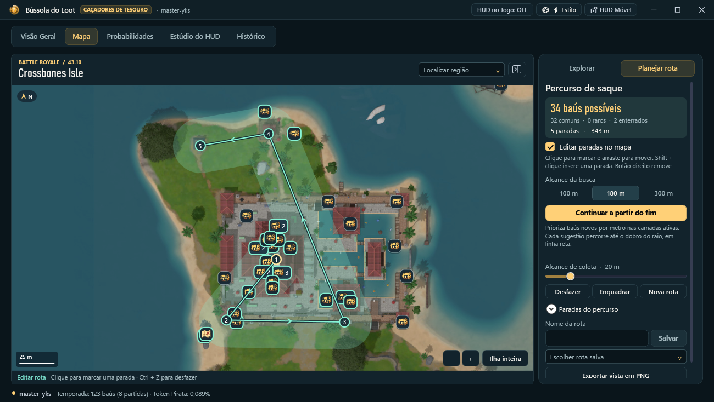

# Bússola do Loot

**Conte seus baús no Fortnite, confira o que o replay registrou do seu esquadrão e planeje a próxima rota em Crossbones Isle.** Aplicativo para Windows x64, em português, por **master-yks**.

## Baixar e começar

1. Na página do repositório, abra **Releases** e baixe **BussolaDoLoot-win-x64.zip** em **Assets**. Os arquivos chamados *Source code* contêm o código para desenvolvedores.
2. Extraia o ZIP inteiro e abra **BussolaDoLoot.exe**. O pacote inclui o runtime .NET. Se quiser um atalho na Área de Trabalho e no menu Iniciar, execute **Criar atalhos.cmd**.
3. Ative a gravação de replays no Fortnite e conclua uma partida pública de **Battle Royale** ou **Construção Zero**. A sincronização também pode ser iniciada pelo botão **Sincronizar** do painel.
4. Em **Visão Geral**, escolha o período e veja seus baús por tipo. No **Histórico**, passe o mouse sobre uma partida para conferir o que entrou na contagem.

**Requisitos** · Windows 10 versão 2004 (build 19041) ou posterior, em arquitetura x64. A estimativa ao vivo usa o OCR do Windows, os avisos de EXP visíveis e o jogo em janela sem bordas. A conferência por replay funciona mesmo quando o OCR está indisponível.


*Exemplo com dados fictícios. O símbolo ≥ mostra o mínimo de baús do esquadrão que apareceu no seu replay. Aberturas distantes podem ficar fora da gravação.*

## Planejar uma rota

Abra **Mapa → Planejar rota**, escolha **Sugerir percurso de baús** e clique no ponto de pouso. Escolha um raio de 100, 180 ou 300 m. O planejador prioriza trechos que alcançam mais baús novos por metro. Arraste os pontos ou reordene as paradas pela lista, salve a rota e exporte a vista em PNG. O mapa da temporada Caçadores de Tesouro vem no aplicativo.



## Mostrar o contador na transmissão

No OBS ou Streamlabs, adicione uma **Fonte de navegador** com a URL `http://localhost:7777/` e mantenha a Bússola aberta no mesmo computador. Na aba **Estúdio do HUD**, escolha o visual e confira a legibilidade antes de transmitir.

| Atalho no Windows | Ação |
| --- | --- |
| Ctrl + Shift + O | Mostrar ou ocultar o HUD no jogo |
| Ctrl + Shift + L | Travar ou liberar a posição do HUD |
| Ctrl + Shift + M | Alternar o estilo |


## Dados e solução de problemas

| Situação | O que conferir |
| --- | --- |
| Minha partida ainda não apareceu | Aguarde o fechamento do replay e clique em **Sincronizar**. Os arquivos ficam em `%LOCALAPPDATA%\FortniteGame\Saved\Demos`. O filtro cobre partidas públicas dos modos indicados acima. |
| A estimativa ao vivo ficou em zero | Confira o idioma de OCR do Windows, o modo de janela e a visibilidade dos avisos de EXP. O replay consolida o resultado depois da partida. |
| Quero fazer backup | Com o aplicativo fechado, copie `%APPDATA%\ChestCounter`. Essa pasta guarda histórico, preferências e rotas. O CSV exportado pode incluir nomes dos colegas e IDs das partidas. |
| Quero conferir o download | No PowerShell, rode `Get-FileHash .\BussolaDoLoot-win-x64.zip -Algorithm SHA256` e compare o valor com o arquivo `SHA256SUMS.txt` da mesma release. |

## Compilar no Windows

Instale o **SDK .NET 10 x64** e abra o PowerShell na raiz deste repositório. A primeira compilação restaura as dependências pelo NuGet.

```powershell
.\scripts\Publicar-Windows.ps1
```

O script verifica a contagem e as rotas, compila a interface e a CLI e grava o ZIP autossuficiente em `artifacts\`. Para verificar contagem e rotas, execute `dotnet run --project tests/ChestCounter.Checks -c Release` e `dotnet run --project tests/ChestCounter.MapChecks -c Release`. A versão distribuída e testada para jogadores é a de .NET. O código alternativo em Rust fica em `rust/` para desenvolvimento e usa um histórico próprio. Neste ambiente, a variante gráfica em Rust compilou com a toolchain GNU, mas encerrou durante a inicialização.

Consulte o passo a passo de exportação, as famílias de baús e as probabilidades no [manual do aplicativo](docs/MANUAL.md).

## Créditos

**master-yks** assina esta edição da Bússola do Loot. O leitor de replays é baseado no trabalho de **Shiqan** e nas adaptações de **LED-N**. A capa foi criada para esta edição com geração de imagem. As capturas mostram o aplicativo em modo de demonstração.

Projeto de fãs independente da Epic Games. O código próprio traz a licença MIT. A distribuição inclui OozSharp, com código de **Powzix** convertido por **SL-x-TnT** sob GPL versão 3 ou posterior. As artes e a cartografia pertencem aos respectivos titulares. [Licença do projeto](LICENSE) · [Origem e licenças dos componentes](lib/README.md) · [Fontes do mapa e das imagens](docs/MANUAL.md)
